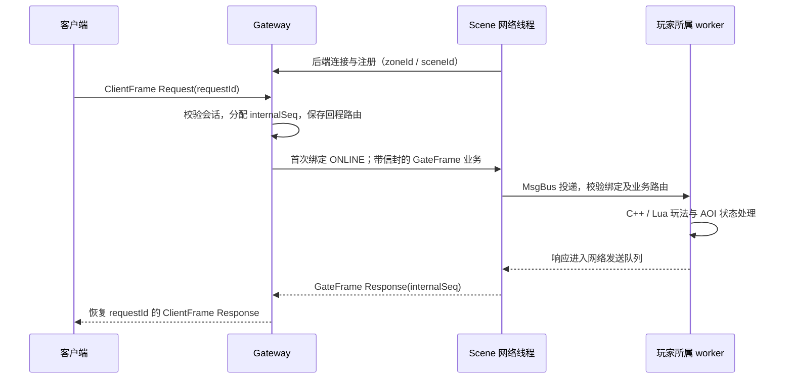

# ClearMoon GameServer

基于 C++20、Lua 和 Protobuf 的 MMORPG 分区分服服务端实验项目。本文只介绍顶层架构、网关与场景服设计、区服关系，以及已有测试的能力边界。实现、配置、构建与运行细节见各服务文档。

## 顶层架构

```text
客户端 ┄┄> LoginServer（待实现：账号认证、登录凭证、区服列表与角色归属查询）
  │
  │ ClientFrame：客户端主动连接所选区服的网关
  ▼
┌────────────────────── 一个 Zone（zoneId）──────────────────────┐
│ Gateway 1 … Gateway G                                        │
│     ▲ GateFrame：后端主动连接，网关经该连接转发业务             │
│     ├── Scene 1 … Scene S：玩法、玩家状态、地图与 AOI           │
│     ├── Chat：同一区服跨网关私聊与喊话                         │
│     └── Global：当前仅 Ping/Echo 接入验证                      │
│                                                              │
│ Scene 内部：网络线程 ↔ MsgBus ↔ 逻辑 worker / Lua / AOI         │
│                            ↔ DB、定时器等辅助线程             │
│ Scene 数据通道：MySQL（角色/快照）、Redis（按区服隔离的键）     │
└──────────────────────────────────────────────────────────────┘
```

LoginServer **待实现**，图中虚线仅表示规划职责，不代表已接通正式登录或入区鉴权。当前网关使用开发期鉴权机制，不能替代正式身份系统。

## Gateway：接入、会话与路由

- 客户端和后端分别使用独立监听入口及 `ClientFrame`、`GateFrame` 协议，不能混用。
- 维护客户端会话、可信玩家身份、服务注册、场景/通道绑定和有界回程路由，不执行玩法或直接访问玩家数据库。
- 后端注册包含服务及区服身份；多 Scene 按 `sceneId` 区分。会话选定具体场景通道后保持绑定，不提供自动迁移或故障接管。
- 转发时分配内部 `seq`，保存客户端 `requestId` 与会话；响应校验来源和身份后恢复客户端请求号。后端推送由网关筛选本地会话并投递。
- 场景业务携带版本化玩家绑定信封。首次声明先提交 ONLINE，稳定绑定后只提交带信封的业务帧；退出发送精确 OFFLINE。声明仅表示交给本地发送路径，不代表场景服已应用。

## Scene：状态所有权与异步数据通道

- 不直接接收客户端连接；网络线程维护网关连接与玩家绑定索引，通过进程内 `MsgBus` 投递到所属逻辑 worker。
- 每个 worker 独占玩家对象、Lua VM、持久化协调器和 AOI 状态；C++ 管理生命周期和基础校验，Lua 承载移动等示例玩法。worker 之间传事件与快照，不共享可变 Player。
- 同一 Scene 进程内通过消息总线同步跨 worker AOI 副本与恢复快照。观察者处理生成视野推送，经网络队列和网关返回；本地队列接受不等于客户端收到。
- DB 线程异步执行 MySQL/Redis 任务，结果回投原 worker。保存使用固定快照、版本校验、去重和 ACK；账本在内存中，不提供崩溃后任务恢复或未知 COMMIT 结果自动对账。
- `PendingDbTasks` 活跃索引只调度仍需处理的任务，保留历史身份及重复结果语义；它是维护成本优化，不等于提高了已测最大吞吐容量。

### 一次场景请求



## 多网关、多场景与多区服的关系

| 层级 | 当前关系与边界 |
| --- | --- |
| 一个 Zone 内的多个 Gateway | 汇聚各自客户端；后端按配置连接网关。网关不自动共享完整在线会话表。 |
| 一个 Zone 内的多个 Scene | 网关按场景与通道绑定路由；跨 worker AOI 只在同一 Scene 进程内同步，不是跨 Scene 迁移。 |
| Chat 与多个 Gateway | Chat 连接同一区服已配置网关，私聊/喊话向网关扇出，各网关筛选本地会话；没有离线消息或可靠送达确认。 |
| Global | 当前只连接一个网关，提供 Ping/Echo；“全局”不代表已实现跨区中心、公会或排行榜。 |
| 不同 Zone | 以 `zoneId` 区分注册与数据命名空间；Redis 键使用 `zone:{zoneId}:...`。MySQL 的库、账号及部署隔离需单独配置，不能仅靠 zoneId 自动保证。 |
| 跨区服业务 | 当前没有跨区聊天、跨区 AOI、角色迁移或统一跨区业务总线。LoginServer 待实现，职责包括提供区服列表与角色归属查询。 |

同一区服增加 Gateway/Scene 是横向部署，不等于不同区服已经互通。MySQL/Redis 是数据通道，不是已实现的跨区实时消息总线。

## 3G2S 最新测试摘要（2026-10-19）

3G2S 指 **3 个 Gateway + 2 个 Scene**。下表为特定移动/AOI 场景的客户端正式负载窗口端到端成功吞吐，不含 drain；不是内部 handled 消息数，也不是单 Scene 吞吐。

| 归档轮次 | 连接与供给目标 | 正式窗口 | 成功 RPS | p99 | 业务错误 / unresolved |
| --- | --- | --- | ---: | ---: | --- |
| 最近一轮：客户端等待优化后 | 512 × 20 RPS = 10,240 RPS | 30 秒 | 10,228.37 | 178.06 ms | 0 / 0 |
| 较早的 60 秒观测 | 512 × 20 RPS = 10,240 RPS | 60 秒 | 10,239.08 | 83.59 ms | 0 / 0 |

最近一轮服务绑定 CPU 0–9、客户端绑定 10–15，仍有早段下探、后段追赶，最大调度滞后约 5.22 秒；较早 60 秒轮不具有相同实验条件，不能直接用两行比较优化收益。两轮有正常退出及在线存储推进证据，但 capacity 模式未逐玩家核对最终 DB 快照。

**可以确认：两个 Scene 合计在特定移动/AOI 场景下已展示短时万级端到端成功吞吐能力。** 不保证单 Scene、混合业务或长期常态稳定万级，最大容量未测定。最近同绑核客户端前后观测为 5,905.83 → 10,228.37 RPS（约 +73.2%），该变化属于客户端等待优化相关观测，不能归为活跃索引收益，且不是严格冻结布局 A/B。

活跃索引的独立 256 连接测试供给封顶约 5,120 RPS，成功吞吐仅 5,119.17 → 5,119.88 RPS；主要证据是维护热点与 CPU 成本下降。完整证据位于本地 `docs/benchmark-results/`，该目录受 `.gitignore` 忽略，不保证随仓库检出提供；诊断时间线已部分无损压缩、运行日志已精简，perf 收尾仍有 exit=-15 限制。

## 文档导航

| 文档 | 维护范围 |
| --- | --- |
| [Gateway](Zone/gatewayServer/README.md) | 接入、会话、路由、配置与运行 |
| [Scene](Zone/sceneServer/README.md) | worker、Lua、AOI、持久化与运行 |
| [Chat](Zone/chatServer/README.md) / [Global](Zone/globalServer/README.md) | 当前业务与职责限制 |
| [线协议](Zone/PROTOCOL.md) | ClientFrame / GateFrame 与业务消息 |
| [监测模块](Zone/sceneServer/src-cpp/metrics/README.md) | 指标、诊断和调度策略 |
| [持久化验收](Zone/sceneServer/tests/PERSISTENCE_ACCEPTANCE.md) | 隔离数据库验证方法与历史结果 |

## 仓库内容与本地文件边界

以 [.gitignore](.gitignore) 和 Git 跟踪状态为准：默认入口是 `Zone/` 源码、各服务 README、线协议和已跟踪验收文档，不依赖本机压测目录。

| 忽略规则 | 内容与说明 |
| --- | --- |
| `docs/*` | 本地专题、历史报告、性能证据和计划；不保证随 clone 提供，不能将本地链接当作仓库已交付文档。 |
| `LoginServer/` | 登录服目录被忽略；LoginServer 待实现，仅承担账号认证、登录凭证、区服列表与角色归属查询职责。 |
| `Zone/build`、`Zone/build-acceptance/`、`Zone/build-readme/`、`Zone/build-worker-pending/`、`Zone/build-worker-pending-release/` | 本地构建与测试输出，需自行生成；当前规则逐项列举，并非通配忽略所有 `Zone/build*`。 |
| `.cline/`、`.cache/`、`.VSCodeCounter/*` | 本地工具、缓存和编辑器统计。 |
| `Zone/*.log`、`Zone/compile_commands.json` | 指定位置的日志/编译数据库；不代表所有目录的日志均被忽略。 |
| `docker-data/`、`Enviromation.md` | 本地容器数据、机器环境记录，不是项目通用运行要求。 |

`.gitignore` 不会自动取消已有文件的跟踪，也不等于文件已删除。根目录 `logs/` 不在当前忽略规则内，已清空的日志未来仍可能重新生成；不要将日志、凭据、证书私钥或测试数据库当作源码交付。本文不修改忽略规则、不强制纳入本地文档。测试数字是当前工作区归档观测，不保证仅 checkout HEAD 即可复现。
