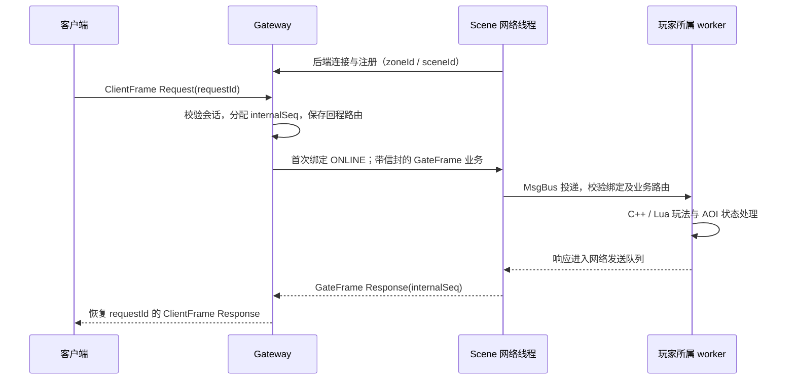

# ClearMoon GameServer

[](https://en.cppreference.com/w/cpp/20)
[](https://developers.google.com/protocol-buffers)

使用 C++20、Lua 和 Protobuf 开发的 MMORPG 分区分服服务端。

## 目录

- [项目简介](#项目简介)
- [顶层设计](#顶层设计)
- [子模块职责与边界](#子模块职责与边界)
  - [网关](#网关)
  - [场景服务器](#场景服务器)
  - [一次场景请求](#一次场景请求)
  - [区服拓扑](#区服拓扑)
- [各子服务器的构建命令](#各子服务器的构建命令)
  - [Gateway](#gateway)
  - [Scene](#scene)
  - [Chat](#chat)
  - [Global](#global)
- [测试数据](#测试数据)
  - [3G2S 移动测试](#3g2s-移动测试)
- [文档导航](#文档导航)

## 项目简介

项目按区服组织服务。网关负责客户端接入和请求路由，场景服处理玩家状态、Lua 玩法、AOI 与存档，聊天服提供区服内私聊和喊话。Global 目前只提供 Ping/Echo，LoginServer 尚未实现。

本文介绍顶层设计、模块分工、构建方法和已有测试结果。服务配置、协议处理和内部实现见[文档导航](#文档导航)。

## 顶层设计

客户端连接所选区服的网关，后端服务主动连接网关并注册。网关转发请求，场景服按玩家所属 worker 执行玩法，再经网关返回响应。

```text
客户端 ┄┄> LoginServer（待实现：账号认证、登录凭证、区服列表与角色归属查询）
  │
  │ ClientFrame：客户端主动连接所选区服的网关
  ▼
┌────────────────────── 一个 Zone（zoneId）──────────────────────┐
│ Gateway 1 … Gateway G                                         │
│     ▲ GateFrame：后端主动连接，网关经该连接转发业务              │
│     ├── Scene 1 … Scene S：玩法、玩家状态、地图与 AOI           │
│     ├── Chat：同一区服跨网关私聊与喊话                          │
│     └── Global：当前仅 Ping/Echo 接入验证                      │
│                                                               │
│ Scene 内部：网络线程 ↔ MsgBus ↔ 逻辑 worker / Lua / AOI        │
│                            ↔ DB、定时器等辅助线程              │
│ Scene 数据通道：MySQL（角色/快照）、Redis（按区服隔离的键）      │
└──────────────────────────────────────────────────────────────┘
```

图中的 LoginServer 是规划中的服务，负责账号认证、登录凭证、区服列表和角色归属查询。当前网关只有开发期鉴权，尚未接入正式登录和入区鉴权。

## 子模块职责与边界

网关管理连接和会话，Scene 管理玩家状态，Chat 和 Global 各自处理登记的业务。数据库与定时器是 Scene 的辅助线程，不直接处理客户端连接。

| 模块 | 负责 | 不负责或尚未实现 |
| --- | --- | --- |
| Gateway | 客户端接入、会话、服务注册、请求和推送转发 | 玩法、玩家数据库、正式账号认证、自动故障接管 |
| Scene | 玩家状态、Lua 玩法、地图、AOI、异步存档 | 公网接入、正式登录、跨进程场景迁移 |
| Chat | 同一区服内跨网关私聊和喊话 | 离线消息、可靠送达确认、管理员广播、跨区聊天 |
| Global | Ping/Echo 接入验证 | 公会、排行榜及其他全区业务 |
| LoginServer（待实现） | 规划负责账号认证、登录凭证、区服列表和角色归属查询 | 当前未接入正式登录流程 |

### 网关

Gateway 管理接入、会话与路由，业务载荷交给后端处理。
- 客户端和后端分别使用独立监听入口及 `ClientFrame`、`GateFrame` 协议，不能混用
- 维护客户端会话、可信玩家身份、服务注册、场景/通道绑定和有界回程路由，不执行玩法或直接访问玩家数据库
- 后端注册包含服务及区服身份；多 Scene 按 `sceneId` 区分。会话选定具体场景通道后保持绑定，不提供自动迁移或故障接管
- 转发时分配内部 `seq`，保存客户端 `requestId` 与会话；响应校验来源和身份后恢复客户端请求号。后端推送由网关筛选本地会话并投递
- 场景业务携带版本化玩家绑定信封。首次声明先提交 ONLINE，稳定绑定后只提交带信封的业务帧；退出发送精确 OFFLINE。声明仅表示交给本地发送路径，不代表场景服已应用

### 场景服务器

Scene 按 worker 划分玩家状态，通过消息总线与网络、数据库和其他 worker 协作。
- 不直接接收客户端连接；网络线程维护网关连接与玩家绑定索引，通过进程内 `MsgBus` 投递到所属逻辑 worker。
- 每个 worker 独占玩家对象、Lua VM、持久化协调器和 AOI 状态；C++ 管理生命周期和基础校验，Lua 承载移动等示例玩法。worker 之间传事件与快照，不共享可变 Player。
- 同一 Scene 进程内通过消息总线同步跨 worker AOI 副本与恢复快照。观察者处理生成视野推送，经网络队列和网关返回；本地队列接受不等于客户端收到。
- DB 线程异步执行 MySQL/Redis 任务，结果回投原 worker。保存使用固定快照、版本校验、去重和 ACK；账本在内存中，不提供崩溃后任务恢复或未知 COMMIT 结果自动对账。
- `PendingDbTasks` 活跃索引只调度仍需处理的任务，保留历史身份及重复结果语义；它是维护成本优化，不等于提高了已测最大吞吐容量。

### 一次场景请求
下图从网关已有鉴权会话开始，不包含尚未实现的正式登录流程。



### 区服拓扑

同一区服可以部署多个网关和场景实例；不同区服的数据隔离和跨区业务需要单独设计。

| 层级                       | 当前关系与边界                                                                                                                         |
| -------------------------- | -------------------------------------------------------------------------------------------------------------------------------------- |
| 一个 Zone 内的多个 Gateway | 汇聚各自客户端；后端按配置连接网关。网关不自动共享完整在线会话表。                                                                     |
| 一个 Zone 内的多个 Scene   | 网关按场景与通道绑定路由；跨 worker AOI 只在同一 Scene 进程内同步，不是跨 Scene 迁移。                                                 |
| Chat 与多个 Gateway        | Chat 连接同一区服已配置网关，私聊/喊话向网关扇出，各网关筛选本地会话；没有离线消息或可靠送达确认。                                     |
| Global                     | 当前只连接一个网关，且只提供 Ping/Echo；其他功能待后续完善                                                                             |
| 不同 Zone                  | 以 `zoneId` 区分注册与数据命名空间；Redis 键使用 `zone:{zoneId}:...`。MySQL 的库、账号及部署隔离需单独配置，不能仅靠 zoneId 自动保证。 |
| 跨区服业务                 | 当前没有跨区聊天、跨区 AOI、角色迁移或统一跨区业务总线。LoginServer 待实现，职责包括提供区服列表与角色归属查询。                       |

同一区服增加 Gateway/Scene 是横向部署，不等于不同区服已经互通。MySQL/Redis 是数据通道，不是已实现的跨区实时消息总线。

## 各子服务器的构建命令

所有命令从仓库根目录执行。需要支持 C++20 的编译器、CMake 3.20 或更新版本、Protobuf 编译器与开发库，以及 Lua 5.4/5.3 开发库。统一工程在配置时也会检查 Scene 的依赖，即使只构建网关也需要 Lua。

MySQL/MariaDB Connector/C 和 valkey/hiredis 开发库用于数据库通道。缺少它们时，CMake 会禁用对应通道；运行持久化功能还需要可访问的数据库服务。

先生成 Release 构建配置；`out/zone` 由 CMake 创建：

```bash
cmake -S Zone -B out/zone -DCMAKE_BUILD_TYPE=Release -DSCENE_BUILD_TESTS=ON
```

再按需构建服务器：

### Gateway

```bash
cmake --build out/zone --target gatewayServer -j 2
```

### Scene

```bash
cmake --build out/zone --target sceneServer -j 2
```

### Chat

```bash
cmake --build out/zone --target chatServer -j 2
```

### Global

```bash
cmake --build out/zone --target globalServer -j 2
```

可执行文件生成在 `out/zone/bin`。先启动网关，再启动后端；各服务器的工作目录、配置参数和测试入口见各自 README。

## 测试数据

已有多网关、多场景的 2G2S 和 3G2S 测试记录。以下数据来自历史运行，本次文档重构没有重新测量；单 Scene 吞吐尚未测定。

### 3G2S 移动测试

**512 连接时，两个 Scene 合计约 1.535 万成功 RPS。60 秒测试零错误通过；600 秒出现 busy，未通过严格检查。**

测试使用 3 个 Gateway 和 2 个 Scene（3G2S），服务、数据库和客户端在同一台机器运行。具体设置：

- Release 构建，每个 Scene 4 个 worker。
- 开启 AOI 和持久化，每秒保存一次。
- 使用事件驱动改造前的旧客户端（即每个客户端连接各分配一个线程），每个连接收到响应后才发送下一条 Walk 请求。

| 归档轮次                             | 连接与供给目标            | 正式窗口 | 成功 RPS  | p99       | 业务错误 / unresolved         | 严格结果 |
| ------------------------------------ | ------------------------- | -------- | ---------:| ---------:| ----------------------------- | -------- |
| 2026-10-20：事件驱动改造前的旧客户端 | 512 × 30 RPS = 15,360 RPS | 60 秒    | 15,358.83 | 96.772 ms | 0 / 0                         | 通过     |
| 2026-10-20：事件驱动改造前的旧客户端 | 512 × 30 RPS = 15,360 RPS | 600 秒   | 15,353.17 | 94.335 ms | 605 次 `1011:server busy` / 0 | 未通过   |

成功 RPS 只统计正式窗口内的客户端成功响应，不含 drain（停止发请求后的排空阶段）。p99 使用三个客户端合并的成功响应样本，包含排空时收到的响应。两项都是端到端指标，不是内部 handled 消息数或单 Scene 吞吐。

600 秒测试有两个明显问题：

| 问题               | 观测                                                                     |
| ------------------ | ------------------------------------------------------------------------ |
| 发请求不均匀       | 最大发送调度滞后约 28.23 秒，每分钟吞吐有波动                            |
| Scene 内存持续增长 | Scene 1 RSS：29.29 → 157.84 MiB；Scene 2：29.34 → 146.34 MiB，未趋于平稳 |

保存与退出检查：两次测试的 512 名玩家都成功登出，两个 Scene 正常退出。请求计数与延迟样本数核对一致，所有受测玩家的在线保存版本都有推进。但没有逐人核对最终坐标，也没有检查背包一致性和重登恢复。

内存增长原因尚未确定，现有排查将 Scene 的 AOI 模块列为重点怀疑对象，仍需验证。万连接能力和最大容量尚未测定；这组结果只适用于上述移动/AOI 场景，不代表单 Scene、混合业务或小时级稳定性。

## 文档导航

| 文档                                                                      | 维护范围                           |
| ------------------------------------------------------------------------- | ---------------------------------- |
| [Gateway](Zone/gatewayServer/README.md)                                   | 接入、会话、路由、配置与运行       |
| [Scene](Zone/sceneServer/README.md)                                       | worker、Lua、AOI、持久化与运行     |
| [Chat](Zone/chatServer/README.md) / [Global](Zone/globalServer/README.md) | 当前业务与职责限制                 |
| [线协议](Zone/PROTOCOL.md)                                                | ClientFrame / GateFrame 与业务消息 |
| [监测模块](Zone/sceneServer/src-cpp/metrics/README.md)                    | 指标、诊断和调度策略               |
| [持久化验收](Zone/sceneServer/tests/PERSISTENCE_ACCEPTANCE.md)            | 隔离数据库验证方法与历史结果       |

文档中的文件链接只指向仓库提供的内容。构建示例从仓库根目录执行，`out/zone` 是由 CMake 新生成的目录，不是预先提供的测试文件。

各 README 描述当前工作区。历史测试结果不代表当前版本已重新通过测试。
