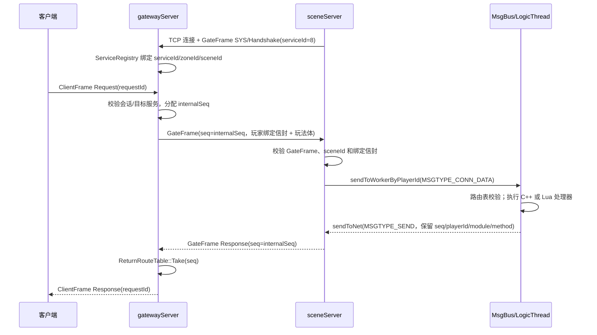

# ClearMoon GameServer

ClearMoon GameServer 是一个基于 C++20、Lua 和 Protobuf 的 MMORPG 分区分服服务端实验项目。本 README 只涉及**当前运行架构、服务职责边界以及服务之间的数据传输方式**；各服务的实现细节、配置、启动命令和测试说明请阅读对应目录下的 README。

## 目录导航

| 服务或主题 | 说明 |
| --- | --- |
| [`LoginServer/README.md `]| HTTPS 登录、账号、短期凭证、区服列表和角色归属查询 |
| [`Zone/gatewayServer/README.md`](Zone/gatewayServer/README.md) | 客户端接入、会话、后端注册、请求转发和推送 |
| [`Zone/sceneServer/README.md`](Zone/sceneServer/README.md) | 玩家绑定、玩法路由、逻辑线程、Lua、AOI 和数据通道 |
| [`Zone/chatServer/README.md`](Zone/chatServer/README.md) | 在线私聊和普通玩家全区喊话 |
| [`Zone/globalServer/README.md`](Zone/globalServer/README.md) | 当前全局服务的 Ping/Echo 接入验证 |
| [`Zone/PROTOCOL.md`](Zone/PROTOCOL.md) | ClientFrame 与 GateFrame 的字段、字节序和业务消息约定 |
| [`docs/整体架构.md`](docs/整体架构.md) | 更完整的架构记录、已实现能力和明确缺口 |

## 当前运行拓扑

```text
                         HTTPS / JSON
        客户端 ───────────────────────────────> LoginServer (暂未实现)
          │                                      │
          │                                      ├─ 账号数据库
          │                                      └─ 区服角色查询库
          │
          │ ClientFrame                           
          ▼
    ┌────────────────┐  GateFrame     ┌──────────────┐
    │ gatewayServer  │<────────────── │ sceneServer  │
    │ 客户端接入与路由│                │ 玩法与场景状态 │
    └──────┬─────────┘                └──────┬───────┘
           │ GateFrame                       │
           │                                 ├─ MySQL：角色/玩家持久化
           │                                 └─ Redis：缓存及相关数据通道
           │
           ├───────────────< chatServer   （在线聊天）
           │
           └───────────────< globalServer （全局服务）

    客户端默认连接网关 ClientFrame 端口：127.0.0.1:10000
    后端服务主动连接网关 GateFrame 端口：127.0.0.1:13145
```

网关是区服内客户端和后端服务的连接汇聚点。场景服、聊天服和全局服不会接受客户端的 `ClientFrame`，而是主动连接网关的后端端口。图中的“公网端口”只表示网关承担客户端接入职责；默认地址是回环地址，并不代表已经对外开放。

`LoginServer` 是独立的 HTTPS 服务，不属于当前 `Zone` 构建中的后端服务注册链路。它访问账号数据库和区服角色查询数据
>————暂未实现

### 一次场景请求的跨服务时序

下面的时序图只展示当前区服的主链路：后端服务先主动注册到网关；客户端请求经过网关生成内部 `seq`，场景服再通过进程内消息总线投递到逻辑 worker，响应沿原路返回。图中的“入队/发送成功”不代表客户端已经收到数据。



## 服务职责划分

### LoginServer——暂未实现

- 提供 HTTPS/JSON 登录入口。
- 负责账号注册、密码验证、短期登录凭证、区服列表和角色归属查询。
- 账号数据由账号数据库负责持久化；角色归属查询读取区服的 `player_profile` 数据。
- 不负责客户端长连接、玩法请求转发、AOI、聊天或全局业务。
- 当前不直接向网关注册，也不负责签发可被现有网关验证的正式入区票据。

### gatewayServer

- 对客户端提供 `ClientFrame` 接入，维护客户端会话、鉴权状态、玩家身份和目标服务绑定。
- 对后端服务提供 `GateFrame` 接入，校验服务握手、区服 ID 和允许的服务号，并维护服务注册表。
- 将客户端请求转换为后端 `GateFrame`，为请求分配内部 `seq`，保存 `seq -> requestId/session` 的回程路由。
- 将后端响应恢复为客户端响应；将后端推送按玩家会话分发给本地客户端。
- 向场景服发送玩家 ONLINE/OFFLINE 绑定通知和带绑定信封的玩法请求。
- 不执行场景玩法，不解析场景业务 Protobuf，不直接访问玩家数据库。

详细内容见 [`Zone/gatewayServer/README.md`](Zone/gatewayServer/README.md)。

### sceneServer

- 维护玩家在场景服内的绑定、逻辑线程、Lua VM、地图和 AOI 状态。
- 按玩家或会话将网关消息投递到所属逻辑 worker；进场、退出等基础流程由 C++ 处理，移动和示例路径等当前玩法由 Lua 处理。
- 负责场景地图校验、玩家实体生命周期、AOI 本地状态以及跨 worker 的场景事件同步。
- 通过独立的数据库和定时器通道处理玩家数据、快照和异步任务；结果再经消息总线投回原逻辑 worker。
- 不直接接收客户端连接，不负责正式登录、网关会话鉴权或聊天路由。

当前客户端视野推送链路尚未完全闭环；AOI 内部状态同步成功不等于其他客户端已经收到视野更新。详细内容见 [`Zone/sceneServer/README.md`](Zone/sceneServer/README.md)。

### chatServer

- 通过网关接收聊天业务请求，不直接接收客户端连接。
- 支持在线私聊：聊天服将消息扇出到已配置的网关，由各网关筛选本地在线目标玩家。
- 支持普通玩家全区喊话：向已配置的多个网关广播，再由网关向本地在线会话推送。
- 不持有玩家在线位置表，不访问玩家数据库，不提供离线消息和可靠送达确认。
- 管理员广播接口当前仅保留占位，不具备可信管理员授权。

详细内容见 [`Zone/chatServer/README.md`](Zone/chatServer/README.md)。

### globalServer

- 通过网关提供当前最小的全局服务接入验证。
- 对 `module=101, method=1` 的请求原样回显二进制 body，用于验证服务注册、路由和响应关联。
- 当前不承担公会、排行榜、全区状态或数据库业务，也不提供自动重连。

详细内容见 [`Zone/globalServer/README.md`](Zone/globalServer/README.md)。

## 服务之间的数据传输

当前区服运行时使用两套相互隔离的 TCP 应用层协议：

| 链路 | 协议 | 用途 | 默认连接方向 |
| --- | --- | --- | --- |
| 客户端 ↔ 网关 | `ClientFrame`，魔数 `0xC1EB` | 客户端控制、业务请求、响应和推送 | 客户端连接网关 |
| 网关 ↔ 区服后端 | `GateFrame`，魔数 `0xC1EA` | 服务注册、业务转发、响应和推送 | 后端主动连接网关 |

两种协议均使用 32 字节固定头，但不能混用：不同端口、魔数和解码入口分别约束连接角色。详细字段和字节序以 [`Zone/PROTOCOL.md`](Zone/PROTOCOL.md) 为准。

### 客户端到网关

1. 客户端通过 `ClientFrame` 发送控制帧完成当前开发期鉴权，或发送业务 `Request`。
2. 网关从已鉴权会话获取可信 `playerId` 和目标服务，不接受客户端在业务帧中自行指定可信身份或后端地址。
3. 网关为业务请求分配内部 `seq`，记录原始 `requestId`、会话、玩家和目标服务，再组装 `GateFrame` 发往后端。
4. 后端响应携带原 `seq`、`playerId`、`module` 和 `method` 返回网关；网关校验回程路由后恢复客户端的 `requestId`，发送 `ClientFrame Response`。
5. 后端主动推送使用 `seq=0`。网关按 `playerId` 查找本地会话；全区喊话使用 `playerId=0` 的广播特例，由网关向本地在线会话分发。

### 网关到场景服

场景服使用 `serviceId=8`，通过 `GateFrame` 主动连接网关。场景相关玩家消息的 body 前置一个 32 字节版本化绑定信封，包含玩家 ID、客户端会话、客户端世代、网关 ID 和场景 ID，之后才是玩法载荷。

- `ONLINE/OFFLINE` 是网关到场景服的内部生命周期通知，不允许客户端直接构造。
- `ONLINE` 只表示网关会话绑定已发布，不表示角色加载完成或已经进入 AOI。
- 场景服校验绑定后，将消息通过进程内 `MsgBus` 投递到玩家所属逻辑 worker。
- 玩法响应通过网络发送队列回到网关，并保留 `seq/playerId/module/method`，由网关完成客户端回程。

### 网关到聊天服和全局服

- 聊天服使用 `serviceId=3`，业务模块为 `100`。聊天请求和响应使用非零 `seq` 关联，推送使用 `seq=0`。
- 全局服使用 `serviceId=4`，当前业务模块为 `101`，以 Ping/Echo 验证请求和响应路径。
- 聊天服可以同时连接同一区服的多个网关；聊天消息由聊天服扇出，网关负责本地在线会话筛选。
- 全局服当前只连接一个网关。
- 聊天和全局业务都复用 `GateFrame`，不定义额外的服务专用帧头。

### 场景服内部数据传输

场景服内部不通过网关转发 worker 之间的 AOI 事件。当前边界如下：

- 网络线程负责 TCP 连接、编解码、网关玩家绑定索引和发送队列。
- 逻辑 worker 独占其玩家对象、Lua VM 和 AOI 服务。
- 定时器结果、MySQL/Redis 结果和跨 worker 场景事件通过进程内 `MsgBus` 投递。
- worker 之间传递事件、快照和状态消息，不共享可变的 `Player` 对象。
- MySQL 和 Redis 是场景服的独立数据通道，不是客户端或其他区服之间的实时消息总线。

## 数据归属与确认边界

- **账号数据**：由 `LoginServer` 使用账号数据库维护。
- **角色与玩家数据**：由 `sceneServer` 的角色/玩家数据通道维护；登录服当前只做角色归属查询。
- **会话和路由状态**：由 `gatewayServer` 在内存中维护，不写入玩家数据库。
- **聊天路由**：由聊天服向网关扇出，网关根据本地在线会话筛选；当前没有离线队列。
- **AOI 权威状态**：由场景服逻辑 worker 持有；跨 worker 副本和事件通过进程内消息传递。

需要区分以下确认层级：进入网络发送队列、TCP `send` 成功、聊天请求返回 `accepted`、数据库提交成功以及客户端实际收到消息并不是同一个确认。当前实现没有把它们统一为可靠投递或端到端确认。

## 构建边界

`Zone/CMakeLists.txt` 当前构建 `sceneServer`、`gatewayServer`、`chatServer` 和 `globalServer`。`LoginServer` 使用自己的 `LoginServer/CMakeLists.txt` 独立构建，不属于 `Zone` 的服务注册和构建入口。

根目录的 `docker-compose.yml` 仅提供 Kafka 开发容器；Kafka 当前不在上述区服运行时数据链路中，也不是 `Zone` 服务构建的必需依赖。————待整体完成后使用