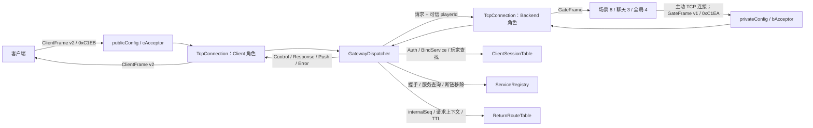
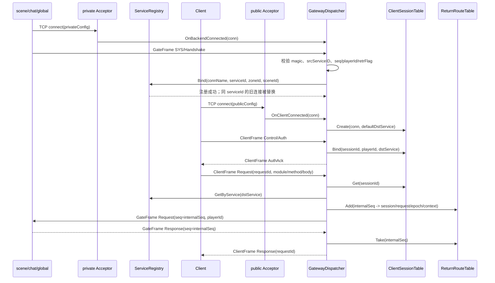
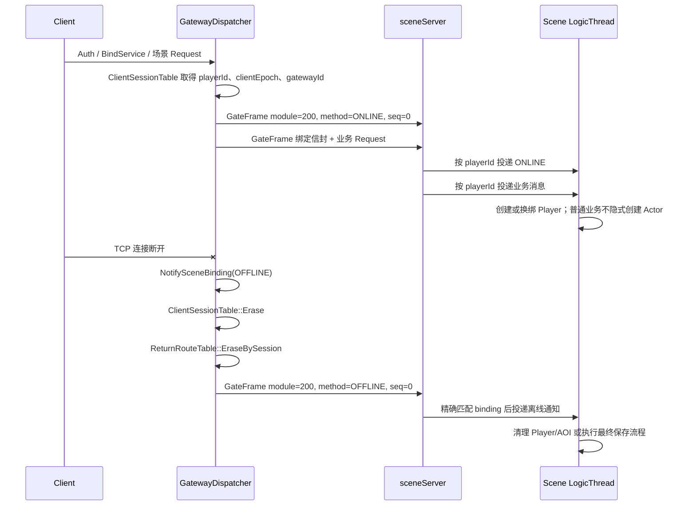
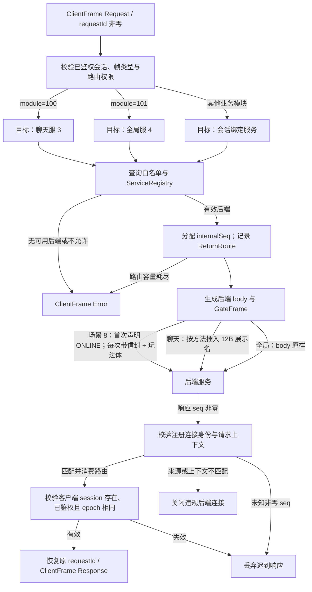
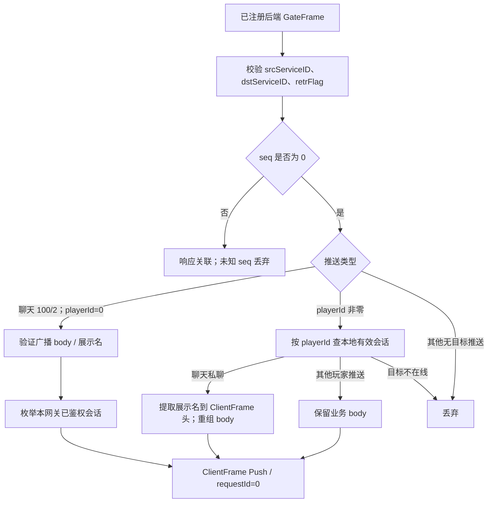
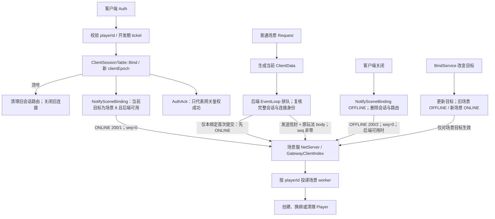

# 网关服务器（gatewayServer）

## 目录

- [本服务器简介](#本服务器简介)
- [构建与运行](#构建与运行)
- [职责边界](#职责边界)
- [功能与协议](#功能与协议)
- [与客户端的消息流](#与客户端的消息流)
    - [客户端与网关交互总览图](#客户端与网关交互总览图)
    - [网关启动、注册与请求回程时序](#网关启动注册与请求回程时序)
    - [玩家绑定与断开清理时序](#玩家绑定与断开清理时序)
    - [消息定义](#消息定义)
    - [网关将结果返回给客户端](#网关将结果返回给客户端)
    - [请求与回程数据流图](#请求与回程数据流图)
    - [后端推送数据流图](#后端推送数据流图)
- [与后端服务器的消息流](#与后端服务器的消息流)
    - [场景玩家绑定数据流图](#场景玩家绑定数据流图)
- [内部组件](#内部组件)
- [内部消息处理流程](#内部消息处理流程)
- [测试](#测试)
    - [旧客户端等待优化与历史 3G2S 观测](#旧客户端等待优化与历史-3g2s-观测)
- [常见排障与交付边界](#常见排障与交付边界)
- [事件驱动压测客户端](#事件驱动压测客户端)
- [小规模内存生命周期诊断](#小规模内存生命周期诊断)

## 本服务器简介

网关负责客户端接入、会话管理和请求转发，不执行玩法，也不提供正式登录服务。

| 入口 | 默认地址 | 协议 |
| --- | --- | --- |
| 客户端 | `127.0.0.1:10000` | `ClientFrame` |
| 后端服务 | `127.0.0.1:13145` | `GateFrame` |

两种协议不能混用。下文图示说明数据如何流转，不代表可靠送达。路径以 `GameServer` 为根目录，构建和测试命令在根目录执行，运行示例会注明工作目录。

## 构建与运行

依赖与公共配置见[主 README](../../README.md#各子服务器的构建命令)。以下命令在仓库根目录执行。

网关配置为 `Zone/gatewayServer/config/gatewayConfig.yaml`。`publicConfig` 只接客户端，`privateConfig` 只接后端；`allowedServices` 必须显式配置，`defaultServiceId` 也必须位于白名单中。`maxClientSessions`、`maxPendingRoutes`、`routeTtlMs` 控制容量与清理。

默认本机配置已对齐：`publicConfig` 的客户端入口为 `127.0.0.1:10000`，`privateConfig` 的后端入口为 `127.0.0.1:13145`；共享配置 `Zone/config/zoneConfig.yaml` 的 `ZoneServer.gateways` 指向后者。跨机器部署仍需将内网监听和网关列表改为可达的内网地址，并限制内网访问。

默认 `zoneId=1`、`gatewayId=1`、`clientToken=998877`、`defaultServiceId=8`，白名单仅含 `8`。要运行聊天/全局服务，须保留 `8` 并加入 `3`、`4`，且使用分行列表；轻量 YAML 解析器不支持 `[8, 3, 4]`：

```yaml
allowedServices:
    - 8
    - 3
    - 4
```

从仓库根目录构建，运行时切换到网关目录。默认配置路径是相对当前工作目录的 `./config/gatewayConfig.yaml`：

```bash
cmake -S Zone \
  -B out/zone -DSCENE_BUILD_TESTS=ON
cmake --build out/zone --target gatewayServer -j 4
(
  cd Zone/gatewayServer &&
  ../../out/zone/bin/gatewayServer ./config/gatewayConfig.yaml
)
```

可以把配置文件路径作为第一个参数传入（相对进程工作目录解析）。日志在运行时生成；当前 `SIGTERM` 直接终止网关进程，**不是**优雅停服。

## 职责边界

网关校验连接和会话身份，后端负责业务处理。以下约束决定请求是否可以转发。

- 网关负责连接、会话、服务注册和转发；不执行场景玩法逻辑，不解析业务 protobuf，也不直接访问玩家数据库。
- 公网和内网分别使用独立的端口、连接角色与帧魔数；收到另一套协议的魔数会断开，而非混用。
- 玩家身份取自鉴权后的会话，客户端业务帧不能指定可信玩家或任意目标地址。`BindService` 只能绑定白名单内的服务；预定义的聊天/全局模块会定向路由，其余业务按会话目标服务转发。
- 当前 `clientToken` 是开发期共享票据，不是正式登录令牌。设为 `0` 会关闭票据校验，**仅限联调**。
- 后端握手使用明文，不能提供密码学认证。目前没有 TLS、主动健康探测或信号驱动的优雅停服。

## 功能与协议

网关按客户端控制帧、业务请求和后端响应分别处理消息。

- **面向客户端**：公网端口接收 `ClientFrame`，处理鉴权、绑定目标服务、Ping/Pong 和业务请求；维护会话与玩家身份。
- **面向后端**：内网端口接受场景服、聊天服、全局服的反向连接，验证握手、区服 ID 和服务号白名单。
- **双向转发**：将客户端请求转成 `GateFrame`；依据回程路由返回响应，或按玩家 ID 转发后端推送。
- **场景玩家绑定**：向服务号 `8` 发送 ONLINE/OFFLINE 和版本化绑定信封；首次声明提交 ONLINE，稳定绑定后的普通业务不再重复声明。

## 与客户端的消息流

客户端控制帧在网关处理，业务请求经会话和回程路由表转发到后端。

```text
Client -- ClientFrame --> publicConfig 端口 / cAcceptor_
       --> TcpConnection(role=Client) --> GatewayDispatcher
       --> ClientSessionTable（鉴权、服务绑定、玩家身份）
       --> ReturnRouteTable（在途请求） --> 后端连接
Client <-- ClientFrame <-- GatewayDispatcher <-- 后端响应/推送
```

### 客户端与网关交互总览图



主 `baseLoop` 管理监听与连接索引，连接 IO 回调在所属事件循环处理。两类连接使用不同解码入口，不能通过在客户端端口发送后端握手来注册服务。

### 网关启动、注册与请求回程时序

时序图对应 `GatewayDispatcher::OnClientConnected`、`OnBackendConnected`、`OnClientMessage`、`OnBackendMessage` 以及 `ServiceRegistry`、`ClientSessionTable`、`ReturnRouteTable` 的当前职责。网关不会等待后端主动来取请求；后端连接建立后由后端先发送握手，客户端请求才可以被转发。



### 玩家绑定与断开清理时序

场景绑定通知属于网关内部的 `module=200` 消息，不是客户端可以直接发送的业务请求。网关按实际场景通道声明 ONLINE，首次业务可与声明合帧提交；稳定绑定不重复声明。客户端关闭时清理会话和回程路由，并按有效绑定发送精确 OFFLINE。通知发送成功不等于场景逻辑 worker 已经应用。



### 消息定义

客户端帧 v2 固定头 **32 B**，魔数 `0xC1EB`、版本 `2`（不兼容旧 v1 客户端）：

| 字段 | 长度 | 含义 |
| --- | ---: | --- |
| magic / version / kind | 2 / 1 / 1 B | `ClientKind`：Request=1、Response=2、Push=3、Error=4、Control=5 |
| module / method | 2 / 2 B | 模块与方法；`module=1` 为客户端 SYS 控制通道 |
| requestId / totalLen | 8 / 4 B | 会话内请求号；总长度包含 32 B 头 |
| roleName | 12 B | UTF-8 角色名、右侧补零；最长 12 字节，不能用于鉴权 |
| body | 可变 | 控制体或业务体；整帧上限 64 KiB |

头部多字节整数使用**网络序（大端）**，定长控制体使用**小端**。权威定义见 `Zone/zone_common/base/clientProto.h`，详细偏移见 `Zone/PROTOCOL.md`。客户端只可发送 `Control(module=1)` 或 `Request(module!=1)`；不能自行发送 Response、Push 或 Error。

| 控制方法（`ClientSysMethod`） | 方向 | 内容 |
| --- | --- | --- |
| `kAuth=1` / `kAuthAck=2` | C→G / G→C | `playerId(u64)+ticket(u64)`；成功回传 playerId、sessionId、epoch、zoneId、目标服务 |
| `kBindService=4` / `kBindServiceAck=5` | C→G / G→C | 白名单内的 `serviceId(u8)` |
| `kPing=6` / `kPong=7` | C→G / G→C | 心跳应答；当前 Pong 体为空 |
| `kAuthFail=3` / `kError` | G→C | 鉴权失败或拒绝，错误体为文本；通用拒绝沿用原请求方法号 |

业务请求须先鉴权且 `requestId` 非零。鉴权失败、未鉴权访问、后端不可用或容量耗尽时发送 `kError`；同一玩家重新登录会顶掉旧会话并清理旧路由。

聊天模块 `100/1`（私聊）和 `100/2`（全区喊话）要求请求头提供非空角色名；网关将该字段插入发往聊天服的业务体。
聊天服回推时网关从推送体读取名字并填入客户端 Push 帧头。名字仅由客户端提供，
**可以伪造，不能用于鉴权或权限判断**。全局服务模块 `101/1` 仍回显 body，不使用名字。
聊天服 `100/2` 的广播推送使用 `seq=0,playerId=0`；网关仅对本地已鉴权会话分发。管理员方法 `100/3` 当前无可信权限来源，只能收到拒绝响应。

### 网关将结果返回给客户端

```text
Request(requestId) --> 会话获取 playerId/目标服务 --> 分配 internalSeq
  --> 记录 (internalSeq -> sessionId, requestId, epoch, module/method, 目标服务)
  --> GateFrame(seq=internalSeq) --> 后端
后端响应(seq=internalSeq) --> 校验来源与上下文 --> 消费回程路由
  --> ClientFrame(kind=Response, requestId=原请求号)
后端推送(seq=0, playerId!=0) --> 按玩家找到会话 --> ClientFrame(kind=Push, requestId=0)
```

非零但未知的 `seq` 不会当成推送；过期、断线或被顶号会话的响应会丢弃。

### 请求与回程数据流图



`ReturnRoute` 保存 `internalSeq → clientSessionId/clientRequestId/sessionEpoch/playerId/module/method/backendServiceId`。不同客户端可以使用相同 requestId，网关用内部 seq 区分。

TTL 到期只回收路由，不主动返回超时响应，也不重试业务请求。

### 后端推送数据流图



聊天跨网关扇出由聊天服完成，网关仅筛选本地在线会话。普通响应不能因为 playerId 当前在线就绕过回程路由；广播仅支持代码中明确允许的聊天喊话，不能将任意 `playerId=0` 帧视为全区广播。

## 与后端服务器的消息流

后端启动后**主动连接网关内网端口**，先发送 `GateFrame(module=SYS, method=kHandshake)` 注册。服务间帧固定头 **32 B**、魔数 `0xC1EA`、版本 `1`；包含 `msgType/retrFlag/module/method/seq/playerId/totalLen/srcServiceID/dstServiceID`，整帧上限 10 MiB。`msgType` 是链路标识，**不是**请求/响应/推送类别。定义见 `Zone/zone_common/base/proto.h`。

```text
Backend -- 握手 GateFrame --> privateConfig 端口 / bAcceptor_
        --> GatewayDispatcher 校验白名单、zoneId 和握手头 --> ServiceRegistry 登记
Client Request --> 网关组 GateFrame(src=网关, dst=目标服务, seq=internalSeq,
                                    playerId=会话玩家) --> Backend
Client <-- ClientFrame <-- 网关回程路由 <-- GateFrame 响应/主动推送 <-- Backend
```

握手体为版本化的 27 B 结构：`protocolVersion(u16)+serviceId(u8)+zoneId(u32)+sceneId(u32)+sceneIncarnation(u64)+targetGatewayId(u32)+channelId(u32)`，整数为小端；GateFrame 头部整数为大端。未注册后端不能发送业务帧，握手成功没有协议层 Ack。正常响应应沿用请求 `seq/module/method/playerId`；网关会校验已注册连接身份及请求上下文。

`ServerID::kScene=8` 是场景服务类型，日志名称为 `SCENE`，不是场景实例编号。实例按 `(serviceId, zoneId, sceneId)` 区分，每个实例可以有多个通道。

- `defaultSceneId=0`：新会话从可用实例中选择；非零时只选择指定实例。
- 会话选定后固定到具体通道，不自动迁移或故障接管。
- 同实例、同通道重连会替换旧连接；进程世代变化后，旧进程的通道失效。

### 场景玩家绑定数据流图



场景信封位于 GateFrame body 开头，32 B，字段均为小端：`magic(u16=0x4750)、version(u16=1)、playerId(u64)、clientSession(u64)、clientEpoch(u32)、gatewayId(u32)、sceneId(u32)`，随后为原始玩法 body。定义见 `Zone/zone_common/base/gatewayPlayer.h`。专用 `module=200` 不允许客户端借场景业务路由指定。

注意事项：

- 客户端 session、场景服内部连接 session、Actor epoch 与 clientEpoch 是不同概念。
- AuthAck 不等待场景 ONLINE 已应用，不表示角色加载或进场成功。首次分配 Scene 后，Online 与首条业务合帧提交；稳定绑定后只发业务帧，仍保留每条业务的 32 B 绑定信封。
- Online 去重以当前会话的 playerId/sessionId/clientEpoch、Scene/channel/incarnation 和进程内唯一连接名为边界。重新鉴权或服务切换清除声明状态；后端断链不自动迁移、不重放业务，旧声明不能用于新连接。
- 所有 Scene 提交（含 Offline）统一排入目标后端 EventLoop。Online 与业务在会话表锁内复核并提交；已关闭、已换 epoch 或已换目标的排队业务会取消并清理回程路由。声明标志仅表示已交给本地发送路径，不是远端确认；Scene 生命周期队列和加载失败错误语义保持不变。
- 网关统计增加 `sceneFrames(business/online/offline)` 和 `sceneDeclareSkipped`，按本地成功提交计数；`backendFramesSent` 包含实际提交的 Scene 生命周期帧。稳定绑定 N 条业务对应 1 帧 Online + N 帧业务，而非 N 组双帧；不能据此推算整体吞吐翻倍。
- 顶号由新的 ONLINE 更新绑定，旧会话关闭不能笼统描述为必定发送 OFFLINE；场景服根据精确绑定/世代过滤旧通知。
- 网关发送 OFFLINE 不承诺场景已应用；内部链路关闭时由场景服枚举该连接绑定并逐玩家清理。
- 目前只针对 `kScene=8` 包装绑定信封；网关/场景服须同步升级。多网关 ID 必须稳定且区服内唯一，跨网关权威接管、同 epoch 断线恢复及进程重启后的世代恢复尚未完善。

## 内部组件

| 组件 | 职责 |
| --- | --- |
| `main.cpp` / `GatewayConfig` | 加载并校验配置，初始化日志、主事件循环及网关。 |
| `GatewayServer` / `Acceptor` | 两个监听器、连接索引、IO 线程池及定期路由清理。 |
| `TcpConnection` | TCP 缓冲、连接角色和连接级流量状态。 |
| `GatewayDispatcher` | 两种帧的处理、鉴权、握手、转发、回包和统计。 |
| `ClientSessionTable` | 会话、玩家绑定、目标服务及顶号。 |
| `ServiceRegistry` | 待注册后端及服务号到连接的映射。 |
| `ReturnRouteTable` | 内部 `seq` 到原客户端请求的映射；容量、TTL 与会话删除。 |

核心接口：`GatewayServer::start/stop` 管理传输层；`GatewayDispatcher::OnClientConnected/Closed`、`OnBackendConnected/Closed` 维护状态；`OnClientMessage/OnBackendMessage` 处理帧，`SweepRoutes` 清理超时请求。`GatewayServer` 在主 `baseLoop` 维护连接索引；连接数据在所属 IO 线程的回调中分发。

## 内部消息处理流程

从启动到断开连接，消息按以下顺序处理。

1. `main.cpp` 加载配置，启动两个 `Acceptor` 及 IO 线程池；按端口赋予 Client/Backend 角色。
2. 收到数据先检查魔数和角色，再按对应帧格式解码，并执行读缓冲、解码错误和帧速率限制。
3. 客户端控制帧完成鉴权、绑定或 Pong；业务帧检查会话与后端，记录有界回程路由后转发。
4. 后端握手后注册；响应由内部序号查回程路由，推送按玩家找会话；连接断开或 TTL 到期时清理状态。

## 测试

测试目标覆盖协议、路由和服务交互，需要 Python 3 及相应后端可执行文件。

```bash
cmake --build out/zone -j 4
ctest --test-dir out/zone \
  --output-on-failure -R '^gateway_'
```

`gateway_tests` 验证协议、配置与路由表；`gateway_smoke` 验证双端口；`gateway_e2e` 使用模拟后端；`gateway_real_scene` 使用真实场景进程；`gateway_chat_global` 验证聊天/全局联调。测试用临时配置，不验证正式鉴权或外部数据库。

历史问题：2026-10-10 的 `gateway_e2e` 模拟后端未适配 ONLINE 帧，把 Auth 后的第一帧误当成移动请求，导致 module/method/seq 断言失败。这是当时的结果；本次未重跑，当前状态待确认。

### 旧客户端等待优化与历史 3G2S 观测

以下是事件驱动改造前的历史结果。旧等待策略位于 `Zone/gatewayServer/tests/loadPollWait.h`，当前客户端已不再调用，独立测试保留供回归参考。

旧版在 Scene 请求等待响应时，不再按无法执行的下一发送时刻唤醒，而是等待可读事件或截止时间，最多等 100 ms。

2026-10-19，3G2S、512 连接 × 20 RPS、30 秒，前后使用相同绑核设置（服务 CPU 0–9，客户端 CPU 10–15）：

| 指标 | 修改前 | 修改后 |
| --- | ---: | ---: |
| 成功 RPS | 5,905.83 | 10,228.37（约 +73.2%） |
| 客户端 CPU | 约 571.8% | 约 314.3% |
| p99 | 402.41 ms | 178.06 ms |

服务端二进制没变，这不是活跃索引的收益。玩家布局动态变化，也不是严格冻结条件的 A/B。修改后早段仍有吞吐下探，最大发送调度滞后约 5.22 秒，尚不能说明长期稳定万级。

当时通过了等待策略 3 用例/13 检查和 3 个黑盒行为测试，本次未重跑。perf 收尾 exit=-15，因此 CPU 数字取自独立资源时间线，不使用不完整的 perf 占比。测试摘要见[主 README](../../README.md)。

仅重跑等待策略局部测试时，从仓库根目录执行（以下不启动负载）：

```bash
cmake --build out/zone --target load_poll_wait_test -j 2
ctest --test-dir out/zone \
  -R '^load_poll_wait_test$' --output-on-failure
```

## 常见排障与交付边界

| 现象 | 检查项 |
| --- | --- |
| 后端注册失败 | 连接的是内网端口、zoneId 一致、白名单含对应服务、握手身份正确 |
| 客户端业务被拒绝 | 已 Auth、Request 类型正确、requestId 非零、目标后端已注册、路由容量未满 |
| 响应被丢弃 | seq 是否有效、来源与 playerId/module/method 是否匹配、会话 epoch 是否过期 |
| 玩家进不了场 | AuthAck 不等于进场；还需发送场景 `3/4` 的 EnterSceneReq |
| 聊天无推送 | 展示名/body 格式、目标是否在已配置网关在线、聊天进程链路是否存活 |

用于生产前还缺少正式登录凭证、加密传输、可靠的上下线确认、自动故障恢复和信号驱动优雅停服。

排障时注意：TTL 只清理路由，send 成功只表示本地提交，聊天 `accepted` 也不代表对方收到或已读。

## 事件驱动压测客户端

`gateway_load_client` 已统一使用 Linux 非阻塞 socket + 水平触发 epoll，不再提供“一连接一线程”执行路径。新增 `--io-threads N`，默认 1，实际线程数为 `min(N, connections)`；保留主线程和按需启用的独立指标采样线程。每个连接仍有独立 TCP、身份、请求号、坐标和在途请求。

实现入口：`Zone/gatewayServer/tests/loadClientReactor.cc`。状态机负责认证、进场、START/ABORT、预热、业务收发、推送、排空、最终 AOI 屏障和登出。

| 项目 | 限制 |
| --- | --- |
| 准备阶段 | 每个 I/O 线程最多同时推进 64 个连接；已准备连接继续接收推送，不逐连接阻塞等待 |
| 连接缓冲 | 输入最多 4 MiB，待写最多 1 MiB；超限报错，不重连 |
| 每轮每连接预算 | 最多生成 16 个请求、解码 64 帧，收发各 64 KiB |
| 在途请求 | Scene 单请求；ping/通用 request 可多请求 |
| 超时 | 连接/认证各 3 秒，进场/登出各 5 秒，发送无进展 2 秒，业务响应 5 秒 |

收到 SIGINT/SIGTERM 后停止生成请求，按 `--drain` 限时排空。等待 START 受 `--preparation-timeout` 限制。周期采样只读取计数；最终 JSON 和延迟样本仍计算精确分位数。

改造时的局部验证使用本地假网关、32 个连接和 C++ 单测，覆盖线程数、分片/合并帧、帧预算、慢连接公平性、错误计数、START/ABORT、信号排空、预热隔离和最终 AOI 文件屏障。这些检查不代表容量通过。后续真实服务测试见[主 README](../../README.md)：万连接尝试在预热阶段退出，未得到有效容量数据。旧 512 × 30 RPS 报告保留，不与新客户端结果混用。

仅构建客户端并运行相关局部验证：

```bash
cmake -S Zone -B out/zone -DSCENE_BUILD_TESTS=ON -DCMAKE_BUILD_TYPE=Release
cmake --build out/zone \
  --target gateway_load_client gateway_load_schedule_tests -j2
ctest --test-dir out/zone \
  -R '^gateway_load_(schedule_tests|reactor_behavior|client_behavior)$' --output-on-failure
```

## 小规模内存生命周期诊断

压测客户端提供两个可选阶段，参数均默认 0，范围 0～300 秒：

| 参数 | 行为 |
| --- | --- |
| `--idle-before SEC` | 进场/START 后保持在线，不发送业务；结束后开始预热和正式测试 |
| `--hold-after SEC` | 业务排空后保持在线、接收推送；结束后执行最终 AOI 屏障和登出 |

启用任一参数后，各连接的阶段时间追加到 `<output>.phases.jsonl`，单位为单调时钟毫秒。请使用新的输出目录。正式指标的 elapsedMs 仍从正式业务开始计算，不包含 idle 阶段。

保护脚本：`Zone/sceneServer/tests/scene_resource_guard.sh`。它只用于隔离的小规模诊断，不能代替容量验收。

LoginServer 尚未实现，规划职责是账号认证、登录凭证、区服列表和角色归属查询；当前网关未接入正式登录。区服关系见[项目架构](../../README.md)。
